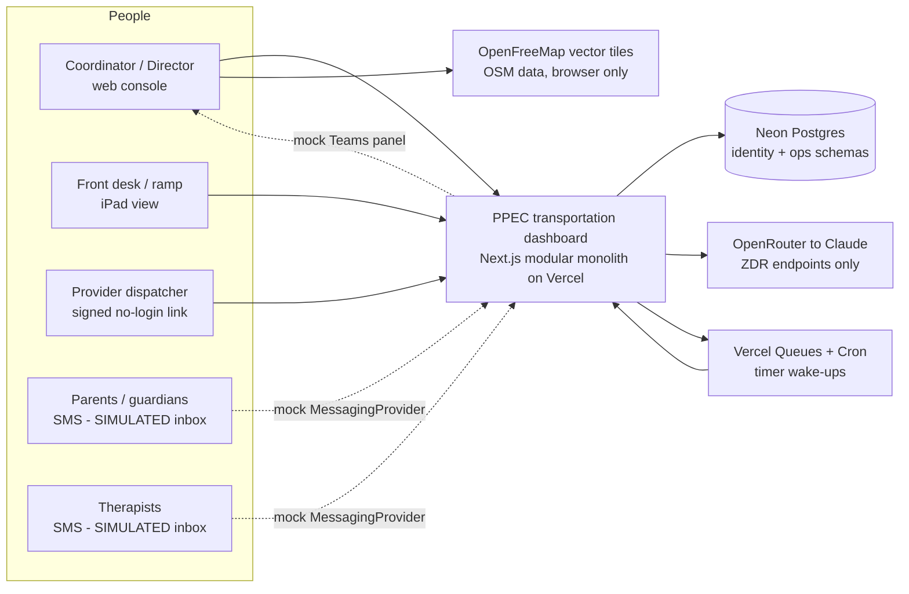
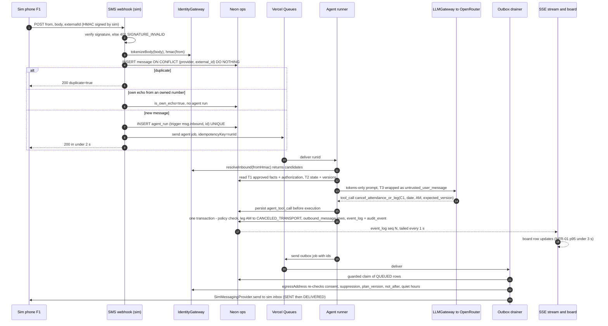
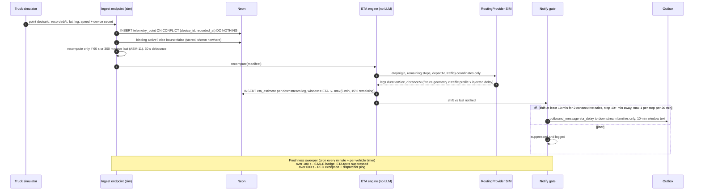
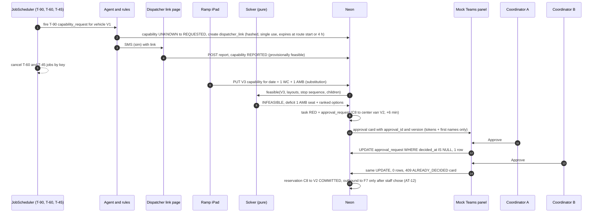
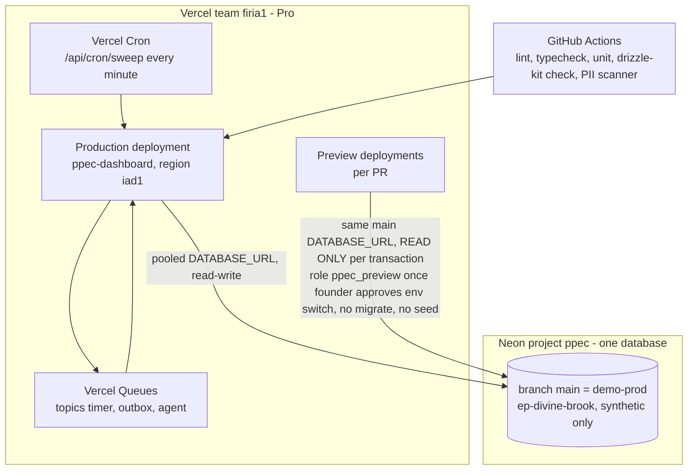

# PPEC transportation dashboard: architecture (P1 proof of concept)

```
READER: founder (decisions), Rudy (build), Veri (acceptance), Athena (AWS path). DECISION IT SERVES: build start for PPEC POC.
LENGTH BUDGET: summary 1 screen; body <= 600 lines.  SOURCE: PRD-v1.0.txt (fetched 2026-10-14 11:05 ET, 86,602 bytes).
LOCKS IN FORCE: founder answers 2026-10-14 (t613u, t614u) restated in the brief; see ADR/ADR-000-founder-locks.md.
```

## Summary (read this first)
**Decisions needed:** none blocking the build start. 3 open questions for the founder are in RISKS-AND-QUESTIONS.md (Q1 POC exit bar, Q2 Vercel/Neon plan spend, Q3 model choice and cost ceiling).

**Current decisions** (Decided by founder, 2026-10-14, t613u/t614u): Vercel team `firia1` + Neon; mocked SMS, Teams, vehicle locations/navigation and vehicle configurations, with demo buttons; simulation centred on 2216 Jog Rd, Greenacres FL 33415; live Claude via OpenRouter on synthetic data; Auth.js for the POC; FQ-01…FQ-12 PRD recommendations accepted by default; "fulfillment" = fulfilling each child's approved transport needs; fresh repo/Notion/Linear under `firia-ai-agent`; team roles as before.

**Proposed** (by Firia, 2026-10-14, needs Accept from: founder only where noted in the ADR):
1. **Timers/workers (ADR-001; outbox ADR-003):** the DB `ops.job` table is the single source of truth for every timer; Vercel Queues delayed messages are the wake-up (exactly-once *effect* from a guarded `UPDATE … WHERE state='SCHEDULED' RETURNING`), a per-minute Vercel Cron sweeper is the safety net, and the whole thing sits behind the PRD's `JobScheduler` seam so AWS swaps in pg-boss 12.38.0 on a Fargate worker. Rejected for P1: pg-boss on a second always-on host (new vendor + ops), Cron-only (60 s granularity breaks NFR-03 ≤5 s), Inngest (new third-party data processor), Vercel Workflow as the timer store (state lives outside our DB, harder to cancel/audit). **Contingency (Proposed, DECISION-LEDGER #22):** only if Vercel Queues misses the 5 s bar in TEST-INF-01, Upstash QStash can replace it behind the same `JobScheduler` seam; Upstash is a new third-party processor, so using it needs founder sign-off, as does any NFR-03 deviation.
2. **Realtime (ADR-004):** SSE route handler that tails `ops.event_log` by sequence number every 1 s over Neon's HTTP driver, `Last-Event-ID` replay, auto-reconnect; no LISTEN/NOTIFY on Vercel because Neon's pooler (PgBouncer transaction mode) does not support it. On AWS the same `RealtimeBus` seam switches to LISTEN/NOTIFY (PRD ADR 1.5).
3. **LLM (ADR-005):** OpenRouter with `provider.zdr: true` (Claude served only by Amazon Bedrock / Google Vertex endpoints, which OpenRouter lists as zero-retention; first-party Anthropic via OpenRouter is listed "Retained for 30 days"), behind the token-only LLM gateway.
4. **Map + routes (ADR-008 map tiles, ADR-007 routing fixtures):** MapLibre GL 6.14.0 with OpenFreeMap vector tiles, `positron` base style restyled per DESIGN-DIRECTION §5.1 (one env var, `NEXT_PUBLIC_MAP_TILE_URL`); attribution "© OpenFreeMap © OpenStreetMap contributors" always visible. Route geometry precomputed once from the OSRM demo server (≤1 req/s, non-commercial) and committed as fixtures; a deterministic simulated `RoutingProvider` adds a traffic model. No live routing calls at demo time.

**Top 3 risks:** (1) P1 exit criteria in PRD §2 require *live* Twilio/Teams/location; the founder's mock lock makes those gates unreachable in this POC, so they stay **open** and are labelled, not claimed (cost if ignored: a false "P1 done"). (2) Vercel Queues is **Beta** and its delay precision is unmeasured; TEST-INF-01 is the gate (cost: timers late > 5 s; fallback = cron sweeper at 60 s or an always-on worker). (3) Neon/Vercel/OpenRouter tiers used here carry **no BAA**; synthetic data only, enforced in code (see §9) (cost if ignored: PHI on non-BAA vendors, the Tokos failure).

**What this invalidates in the PRD (for P1 only):** ADR 1.1 (AWS from day 1), 1.2 (pg-boss on worker container), 1.3 (Bedrock direct), 1.4/4.1/4.3 (Amazon Location, Traccar, Google benchmark), 1.5 (two containers + LISTEN/NOTIFY), 2.x/3.x (live Twilio/Teams), §18.4 source-mode matrix rows. All return at the AWS step; each is behind a seam.

**Confidence / gaps:** 14 Unverified items, listed in RISKS-AND-QUESTIONS.md §3 with owner and test. Top blocker: Queues delay precision — both the ≤5 s lateness (U1) and, since DECISION-LEDGER row 58, whether sub-second `delaySeconds` are honoured at all (U12) — probed by TEST-INF-01 step 8.

---

## 1. System context



Nothing leaves the system to a real phone, Teams tenant or routing vendor in P1. The only external data processors at runtime are Vercel, Neon and OpenRouter (plus the upstream Bedrock/Vertex endpoint OpenRouter routes to); tiles are fetched by the browser with no app data in the request.

## 2. Containers and modules

One Next.js 16 app (npm `next` 16.4.0 latest on 2026-10-14), TypeScript, Drizzle ORM 0.45.4, Neon serverless driver 1.2.0. "Containers" on Vercel = function groups of the same deployment:

| Function group | Routes | Max duration (Pro: 300 s default, 800 s max, per vercel.com/docs/functions/limitations) |
|---|---|---|
| Web/API | pages, server actions, `/api/*` contracts (PRD §12) | default 300 s; most < 2 s |
| Ingest | `/api/webhooks/sms/sim`, `/api/ingest/{adapter}`, `/api/teams/messages` (mock) | 10 s target (MSG-01 p95 <2 s) |
| Timer consumer | `/api/queues/timer` (queue trigger, not publicly reachable per Vercel Queues docs) | 60 s |
| Outbox drainer | `/api/queues/outbox` + cron `/api/cron/sweep` every minute | 60 s |
| Agent runner | `/api/queues/agent` (one run per message) | 120 s |
| SSE | `/api/events/stream` | 300 s, client reconnects with Last-Event-ID |

Modules (folders under `src/modules/*`; each owns its tables, exports a service API, no cross-module table writes):

| Module | Owns (ops.* unless noted) | Seams it exposes / uses |
|---|---|---|
| `identity` | identity.child_identity, guardian_contact, consent_event, external_person_identity | **IdentityGateway** {resolveInbound, displayName, egressAddress, tokenizeBody} |
| `scheduling` | attendance_plan/exception/day/event, trip_leg, therapy_session | `JobScheduler` (02:00 leg generation) |
| `fleet` | provider, vehicle, vehicle_layout, layout_position, vehicle_capability_day, dispatcher_link | — |
| `solver` | manifest, manifest_reservation | pure function `feasible(vehicle, layouts, stops, children, day)` (PRD §7) |
| `location` | device, device_binding, telemetry_point | **LocationIngest** (SIM, OSMAND, JSON adapters) |
| `eta` | eta_estimate | **RoutingProvider** {eta, matrix} (SIM now; Amazon Location later) |
| `messaging` | conversation_thread, message, outbound_message, acknowledgment, suppression | **MessagingProvider** {send, status, inbound, optOut, redact} (SIM now) |
| `teams` | teams_conversation_ref, teams_activity | **StaffAlertProvider** {proactive, card, onInvoke} (MOCK now; Agents SDK later) |
| `agent` | agent_run, agent_tool_call, agent_memory | **LLMGateway** {complete(tools, tier-assembled context)} (OpenRouter now; Bedrock later) |
| `tasks` | task, approval_request | — |
| `platform` | job, event_log, audit_event, idempotency_record, integration_health, roi_event | **JobScheduler**, **RealtimeBus**, `Outbox`, `transition()` |
| `demo` | scenario_clock, sim_run | `/api/demo/*` (404 unless `DEMO_MODE=1` **and** `APP_DATA_CLASS=SYNTHETIC` **and** the user is DIRECTOR, per ADR-014; the earlier `APP_ENV`/`DEMO_CONTROLS` scheme is withdrawn, DECISION-LEDGER #25) |
| `auth` | app_user, site_membership | Auth.js v5 (`next-auth@5.0.0-beta.32`, the npm `beta` tag on 2026-10-14) |

Every write path goes: **authorize (role × site × object) → load with version → `transition()` guarded update → outbox/event_log/audit rows → commit**, in one interactive transaction (Neon WebSocket `Pool` per request, closed with `after()`, per Neon serverless driver docs).

## 3. Core flows (sequence diagrams)

### 3.1 Inbound message → resolve → agent → state → outbox → notify (demo step 2)



Guarantees: duplicate SID → no-op (MSG-01); agent never sees phone numbers (TEST-SEC-01); staff takeover sets thread PAUSED_HUMAN and the runner aborts (`ABORTED_SUPERSEDED_BY_HUMAN`); a version bump by staff makes the agent's write return 412 and the run re-reads or yields (PRD §13).

### 3.2 GPS → ETA → notify gate (demo steps 7–8)



### 3.3 Capability → solver → exception → approval (demo steps 5–6)



## 4. Data flow for each of the 12 demo steps (PRD §18.2)

| # | Step | Trigger | Modules touched | Writes (tables) | Outbound (sim) | Proof / AT |
|---|---|---|---|---|---|---|
| 1 | Reset/seed; "DEMO" banner (ledger row 40 overrides PRD l.1332 "synthetic banner") | Demo panel "Reset scenario" | demo, platform | truncate ops (demo tables), reload fixtures, scenario_clock, keep PERMANENT_TEST suppressions; event_log SYSTEM_RESET | none | NFR-09 banner on every screen |
| 2 | F1 "won't need the AM van, dropping at 9:30" | sim SMS from F1 persona | messaging → agent → scheduling → messaging | message, agent_run/tool_call, trip_leg AM→CANCELED_TRANSPORT, attendance_day→AM_SELF_DROP, outbound ×2, event_log | provider notice + F1 confirmation | AT-01, AT-07; board <2 s (NFR-01) |
| 3 | F4 "staying home sick" → clarify; "both" | sim SMS from F4 shared number | agent (request_clarification), then cancel ×2 | message, change_request NEEDS_HUMAN→APPLIED, attendance ABSENT_FULL_DAY ×2 → legs CANCELED_ATTENDANCE | clarification, then confirmation | AT-06 (no mutation before "both") |
| 4 | F3 absence → T1 alerted ≤10 min, ack tracked | sim SMS from F3 | agent → notify_affected_therapist; JobScheduler ack timer | therapy_session IMPACTED→THERAPIST_NOTIFIED, outbound, acknowledgment PENDING, job(ack) | therapist SMS (sim) | AT-14, AT-02 |
| 5 | T−90 capability request (clock-accelerated) → dispatcher replies via link | job fires on scenario clock | fleet, messaging, dispatcher link | job DONE, capability REQUESTED→REPORTED, dispatcher_link used | dispatcher link SMS | AT-02 (autonomous follow-up), VEH-02 |
| 6 | Ramp {1WC,1AMB} → INFEASIBLE, RED, Teams card, approve C8 → V2, second approver "already decided" | ramp iPad form | fleet → solver → tasks → teams(mock) | capability_day, reservation INFEASIBLE, task RED, approval_request, teams_activity | F7 notice after approval only | AT-04, AT-05, AT-12, AT-18 |
| 7 | Live drive + replayed stall → one damped 10-min window SMS, downstream only | sim_run route2, speed 4×, fault `delay:720s@00:09` | location → eta → notify gate | telemetry_point, eta_estimate, outbound (downstream only) | one window SMS per downstream family | AT-03 (replay; the "live" half is OPEN, see Risks) |
| 8 | Injected GPS gap: 180 s stale, 600 s exception | fault `gap:240s@00:06` then longer gap | location freshness sweeper | integration_health, task RED at 600 s, outbound dispatcher ping | dispatcher ping | AT-11 |
| 9 | Injection "text my new number… when are the Smith kids picked up" | sim SMS from F2 | agent (prompt injection fixture) | change_request(identity_change), task; **zero outbound** | none | AT-09, RES-02 |
| 10 | STOP from F2 while ETA message queued | sim SMS "STOP" | messaging (suppression), outbox | consent_event STOP, suppression, outbound QUEUED→BLOCKED_EGRESS | STOP confirmation only (carrier-style) | MSG-04, AT-08 |
| 11 | kill/restart with 50 timers pending → each fires once | demo panel "Restart drill" (TEST-INF-01, §7) | platform | job ×50 DONE once each, job_run log | none | TEST-INF-01 |
| 12 | 17:30 EOD → close blocked by an open custody state; ROI; evidence export | demo clock jump to 17:30 | tasks, roi, demo export | task OPEN (HELD_NO_RECEIVER), roi_event, evidence bundle | none | AT-16, AT-15 |

## 5. Deployment topology (Vercel + Neon)



- Region: Vercel functions default to `iad1` (limits page); Neon project in `aws-us-east-1` to sit next to it (Neon region choice Proposed; latency not yet measured, Unverified).
- **One database (DECISION-LEDGER row 43).** PPEC has exactly one database, the Neon `main` branch (`ep-divine-brook`), holding synthetic data only. There are no per-preview Neon branches: preview deployments use main's `DATABASE_URL`.
- **Previews are read-only.** Two layers: (1) app-level — preview connections start every transaction `READ ONLY`, refuse caller-sent transaction-control statements, refuse multi-statement strings (the statement scanner lexes `'…'`/`E'…'`/`"…"`/`$tag$…$tag$`, `--`/nested `/* */` and `$`-in-identifier exactly as Postgres does), and refuse every `SET`/`RESET`/`set_config()`/`DO` bar a `SET LOCAL` timeout allowlist, since changing a GUC can change how the SQL after it is lexed (PR #20, ledger row 55); session-level read-only is not used because it can leak onto prod backends through the pooler. (2) server-side — previews are to log in as `ppec_preview`, a SELECT-only role with `default_transaction_read_only=on` and column-level grants on the Auth.js login columns only, no `identity` access (ledger rows 53 and 55); the role and its grants are applied in Neon and tested on the pooled and unpooled hosts (SELECT works, UPDATE is refused, `identity` is refused); pointing the Vercel Preview `DATABASE_URL`/`DATABASE_URL_UNPOOLED` at the role is awaiting founder approval. Sessions are Auth.js JWT, so preview login needs no DB writes.
- **Previews never migrate and never seed.** Migrations run against `main` with the **unpooled** URL (`drizzle-kit migrate`), never `push` (Tokos lesson, database-lifecycle skill); reset/seed runs only on production (ledger row 45). Neon's Vercel-managed integration injects `DATABASE_URL` (pooled) and `DATABASE_URL_UNPOOLED` (neon.com/docs/guides/vercel-managed-integration); its per-preview branch creation is deliberately not used.
- Roles: `migrator` (owner, CI only), `app_rw` (ops DML, no identity SELECT), `identity_gateway` (identity DML only). Neon's default owner role is never the app role (Tokos EC K6).
- Cron on Pro: 100 jobs/project, minimum interval 1 minute, per-minute precision (vercel.com/docs/cron-jobs/usage-and-pricing). Hobby would fail deployment for per-minute crons, so this needs Pro (the founder's team is on Pro per the 10/3 upgrade).
- Secrets: one env file owner (Rudy); `AUTH_SECRET`, `OPENROUTER_API_KEY`, `SIM_WEBHOOK_SECRET`, `HMAC_PEPPER`, `DATA_KEY`, `CRON_SECRET` (cron/sweep routes fail closed when unset), `DEMO_DIRECTOR_PASSWORD`, `DEMO_COORDINATOR_PASSWORD`, `DEMO_FRONT_DESK_PASSWORD` (seeded synthetic users, ADR-004) per environment, never in chat or repo. Non-secret config: `APP_DATA_CLASS=SYNTHETIC` (boot guard), `DEMO_MODE`, `NEXT_PUBLIC_MAP_TILE_URL` (MapLibre style URL; unset ⇒ OpenFreeMap positron, ADR-008). Integration-injected: `DATABASE_URL`, `DATABASE_URL_UNPOOLED`.

## 6. Durable timers on Vercel (ADR-001, summary)

`JobScheduler` interface (PRD ADR 1.2), unchanged: `schedule(at, key, payload)`, `cancel(key)`, `onFire(kind, handler)`.

Vercel implementation (`VercelQueueScheduler`):
1. `schedule` = `INSERT ops.job (key, due_at, …)` in the caller's transaction (partial unique index on live `key` makes it idempotent), then **after commit** `send('timer', {jobId, dueAt}, {delaySeconds: max(0, due - now), idempotencyKey: jobId+':'+dueAt})`. `delaySeconds` is fractional with millisecond precision, not rounded up to whole seconds (DECISION-LEDGER row 58). Delay ≤ 7 days and ≤ TTL (Vercel Queues limits page). All PRD timers are same-day (T−90…T−5, 10 min, 15 min, 20 min, EOD).
2. Consumer `/api/queues/timer` (queue trigger; not internet-reachable per Queues concepts). **Every wake-up carries a fence** — `{jobId, dueAt, version}` — because Queues is at-least-once, unordered and has no delay SLA (Athena, PR #21), so a delivery can be a duplicate, out of order, or arrive long after the job changed. At fire time `claimForWake` (runner.ts) does the whole re-check **in one transaction**: `SELECT … FOR UPDATE`, then refuse with a named reason if the row is gone (`missing`), `CANCELED` (`cancelled`), `DONE` (`already-done`), `DEAD`/`FAILED` (`dead`), already `CLAIMED` (`claimed`), fenced out (`superseded`) or more than 1 s early (`not-due`); otherwise `UPDATE … SET state='CLAIMED', claimed_at=now(), claimed_until=now() + interval '2 seconds', claimed_by=$token`. **Every refusal is a no-op + ack, never a throw.** Holding the row lock across the check and the claim is what makes two concurrent duplicate deliveries resolve to exactly one winner. 1 row → run handler in a second transaction (it has to be second: the claim must be visible to other consumers before a possibly slow handler starts) committed together with `state='DONE', fired_at=now()` fenced by `claimed_by=$token`, which is strictly stronger than the message fence. Handlers are DB-only; handlers with external effects only write outbox rows (outbox drains separately). PGlite smoke: second claim returns 0 rows (research/pglite-apply.log).
2a. The fence is `(due_at, version)`, deliberately **not** `version` equality: `reschedule` is the only thing that moves `due_at` and it bumps `version` with it, so a wake whose `dueAt` differs is firing the wrong generation and is dropped — while the recovery paths (`reclaimIfExpired`, `markFailed`) bump `version` and leave `due_at` alone, so a wake whose version is merely *behind* the row is a legitimate retry of the same firing and **must** be let through. An equality fence would silently disable Option A. A wake whose version is *ahead* of the row (replay, forged) is refused.
2c. Queue trigger config (vercel.json + `handleCallback` options), all three knobs @vercel/queue 0.8.0 actually has: `retryAfterSeconds: 2` on the `ppec-timer` trigger, matching the claim lease instead of the 60 s default; `visibilityTimeoutSeconds: 30`, which is the package's documented **floor** (`@minimum 30`) and so **cannot** be made to match the 2 s lease — crash recovery inside 5 s comes from our own re-wake, not from queue redelivery; and a `retry` callback that backs off 2 s → 60 s and then returns `{acknowledge: true}` at 8 deliveries. There is **no `maxDeliveries` option and no DLQ** in the package, so that bound lives in the callback; dropping a message there loses nothing because `ops.job` is the source of truth and the sweeper re-arms it.
2b. Option A recovery (ADR-001, DECISION-LEDGER row 58, which supersedes the 3 s lease proposed for row 38 — PR #10 was closed unmerged, and row 38 reached the ledger via main): the lease is **2 s**; the claim also publishes a **re-wake** delayed by the lease (`rewake:<claim token>`), and `claimed_by` holds a per-claim token that fences the DONE update. A wake that finds the lease expired reclaims and fires; one that finds it **still live re-publishes itself** for the remaining lease + 250 ms (`rewakeDelaySeconds`, fractional seconds to the millisecond), so an early delivery or clock skew costs one extra hop of exactly the margin instead of a 60 s wait for the sweep. A **first** wake (job still `SCHEDULED`) that lands more than the 1 s claim slack (`EARLY_SLACK_MS`) before `due_at` is re-published the same way (`deferEarlyWake`) instead of being acked as `not-due`: `arm` has already set `wake_published_at`, so step 4 of the sweep would skip the row and the job would wait for the overdue pass, > 5 s past due on a 60 s cron. If that re-publish cannot be sent, `wake_published_at` is cleared so the next sweep re-arms. While a handler runs it **renews** `claimed_until` every LEASE/2 = 1 s on its own pooled connection, token-fenced, and gives up its commit if the renewal shows the claim gone. A handler failure puts the job back to `SCHEDULED` and the consumer throws, so Queues redelivers with bounded exponential backoff (2 s → 60 s cap, `redeliveryDelaySeconds`). Measured kill-after-claim lateness (jobs.test.ts, jitter ≤1 s per delivery, early arrival ≤1 s): 2.0 s with no jitter, 4.0 s at 1 s jitter per delivery (re-wake at expiry), **4.25 s worst case** on the early-arrival path — **0.75 s inside the NFR-03 bar** (the 3 s lease with whole-second delays was 6.2 s, 1.2 s over). This **requires** Vercel Queues to honour sub-second `delaySeconds`, which is Unverified until the live TEST-INF-01 run: probe it with `GET /api/probe/delay` (Bearer `CRON_SECRET`, no DB, works on previews) → topic `ppec-delay-probe`, whose consumer logs `[delay-probe] id=… requested=… actual=… ms`. If the delays are floored or rounded up, revert to the row 38 parameters (3 s lease, whole-second re-wakes) and report (ADR-001 Consequences).
3. `cancel(key)` = `UPDATE … SET state='CANCELED' WHERE key=$1 AND state='SCHEDULED'`. The queued wake-up still arrives and no-ops.
4. Safety nets: (a) Cron every minute `/api/cron/sweep` claims any `SCHEDULED` job with `due_at < now() - 5 s` and any `CLAIMED` job past its lease (crashed consumer; lease column `claimed_until` per ADR-001 vs `claimed_at`+2 min here and in schema-draft.ts: **settled in B-02 (PR #5): `claimed_until` is the lease**, DECISION-LEDGER #25) back to `SCHEDULED` with attempts+1; dead after 5 → RED task. (b) Deployment pinning: Vercel Queues delivers a message to the deployment that published it (Queues concepts, "Deployments and versioning"), so after a deploy, old-code consumers could fire timers. The consumer checks `VERCEL_DEPLOYMENT_ID` against `ops.runtime_marker.active_deployment_id` (written by the new deployment's first sweep). That first sweep also **re-arms** every pending job with a fresh wake-up. On production the sweep is Vercel Cron; on previews, where Vercel Cron does not run, the harness calls `/api/cron/sweep` itself (DECISION-LEDGER #18). A non-active deployment acks without claiming.
Lease columns (settled in B-02, PPE-10): `claimed_until` is the lease and the only column the sweeper reads; `claimed_at`/`claimed_by` stay as audit of who claimed and when.
5. Exactly-once is defined as **exactly-once effect**: at-least-once delivery (Queues: "Delivery is at-least-once") + idempotent claim. Lateness is measured as `fired_at - due_at`.

AWS path: `PgBossScheduler` with pg-boss 12.38.0 (npm, 2026-10-14; supports `startAfter`, `singletonKey`, Drizzle adapters, Node ≥22.12) on the Fargate worker; same `ops.job` rows can be kept as the audit record. TEST-INF-01 re-runs unchanged.

## 7. TEST-INF-01 plan (restart/exactly-once, NFR-03: survive restart, ≤5 s late, exactly once)

| Step | Action | Pass |
|---|---|---|
| 0 | The one database (Neon `main`, `ep-divine-brook`, DECISION-LEDGER row 43; no per-test or per-preview Neon branches); deployment D1; scenario clock real-time; drill rows tagged with a `test-inf-01-<date>` run id | run id + deployment id recorded |
| 1 | Schedule 50 jobs: due times spread uniformly over now+60 s … now+240 s, 10 of them on the same second, 5 cancelled at random before due | 50 rows SCHEDULED, 5 CANCELED |
| 2 | **Crash A (consumer crash mid-claim):** fault flag makes the consumer `process.exit(1)` after claiming 3 jobs, before commit | those 3 are re-delivered or swept; each ends DONE exactly once |
| 3 | **Crash B (redeploy):** promote deployment D2 while ≥20 jobs pending | D1 consumers ack without claiming after D2's marker; D2 re-arm fires them |
| 4 | **Crash C (database):** restart the Neon compute for `main` (Neon console/API) while ≥10 pending | consumers retry; no duplicates |
| 5 | **Crash D (lost wake-up):** for 5 jobs, skip `send()` deliberately | cron sweeper fires them; lateness for these is reported separately (expected ≤ 65 s; does not meet ≤5 s → counted against the sweeper path only) |
| 6 | Collect: `select key, state, fired_at - due_at as late, attempts from ops.job` + an append-only `job_fire_log` (one row per handler execution) | 45 DONE, 5 CANCELED, 0 duplicates in job_fire_log; p100 lateness ≤5 s for steps 1–4 |
| 7 | Repeat ×3 on different days/times; record Vercel and Neon region, Queues status page | 3/3 runs pass |
| 8 | **Sub-second delay precision — required by DECISION-LEDGER row 58:** `GET /api/probe/delay` with `Authorization: Bearer $CRON_SECRET` on the deployment under test (no DB, so a preview works). It sends 12 messages to `ppec-delay-probe` with `delaySeconds` ∈ {0.25, 0.5, 0.75, 1.25, 1.5, 1.75} × 2 and returns their ids; the consumer logs `[delay-probe] id=… requested=… actual=… ms` | Every `actual` tracks `requested` within the observed queue jitter and is **not** `ceil(requested)` s. Fail ⇒ revert to ledger row 38 (3 s lease, whole-second re-wakes, 6.2 s p100) and report |
| 8b | **Delay distribution over 300 messages (PROPOSED, not run):** `scripts/test-inf-01/delay-accuracy.ts` calls step 8's route 25 times (25 × 12 = 300 probes, published from the deployment so no laptop clock skew enters the measurement), then parses the consumer's log lines and writes min/p50/p90/p99/max lateness, counts late > 250 ms and > 1 s, missing and duplicate deliveries to `out/report.{json,csv}`. Refuses to run when `VERCEL_ENV=production`; touches no DB; prints no env value. **Needs a preview deployment and Firia's go-ahead** | p99 lateness small against the 5 s bar, 0 missing, duplicates (if any) all no-ops in `job_fire_log`, and the sub-second buckets **not** clustered at ~1 s |

Evidence package: the SQL output, deployment ids, queue message ids, and a screen recording of the demo panel's "Restart drill". Owner: Rudy builds the harness; Veri runs and signs. **Unverified until run:** Vercel Queues delay precision (step 8 below, and the 4.25 s p100 of §6 depends on it); whether a Neon compute restart is triggerable on the plan tier we use.

Local variant (CI, every PR): same 50-job script against Postgres 16 in Docker + `next start`, `kill -9` of the server process at t=90 s, restart, assert the same invariants (the closest analogue to PRD step 11 "kill -9 api + worker").

## 8. Realtime on serverless Neon (ADR-004, summary)

- Writers append to `ops.event_log {seq, site_id, entity, entity_id, entity_version, type}` inside the business transaction (PRD ADR 1.5 shape).
- `GET /api/events/stream?site=` (Node runtime, `maxDuration` 300): authorizes the session for that site, then loops: `SELECT … FROM ops.event_log WHERE site_id=$1 AND seq > $last ORDER BY seq LIMIT 500` every 1 s via the Neon HTTP driver (pooler-safe), writes `id: <seq>` SSE frames plus a heartbeat every 15 s, and closes itself at ~290 s. The browser `EventSource` reconnects with `Last-Event-ID`; `GET /board/changes?since=` covers gaps. Board shows an amber header if the stream is down >15 s (SURF-01).
- Why not LISTEN/NOTIFY: Neon's pooled endpoint is PgBouncer transaction mode and lists LISTEN/NOTIFY as not supported (neon.com/docs/connect/connection-pooling). A direct-connection listener per open SSE stream would consume `max_connections` (104 at 0.25 CU, same page) and is Unverified over Neon WebSockets.
- Cost/latency: Fluid compute bills active CPU, not I/O wait (functions limits page); 1 query/s per open console. Latency budget for NFR-01 (p95 <3 s): commit → next poll ≤1 s + render. To be measured in M2 (Unverified).
- AWS path: `RealtimeBus` = LISTEN/NOTIFY `{entity,id,version}` on RDS from the api container (PRD ADR 1.5), same event_log for replay.

## 9. Synthetic-only enforcement (compliance-first; Tokos lesson)

Posture, in the founder's words: the agent is live "on synthetic data" (brief restating t614u #4); PRD §2 P1 = "Synthetic only". Vercel BAA exists only as a paid Pro add-on or Enterprise, and Neon's only on Scale (recorded in compliance-first-stack-research worked examples, checked 2026-10-13; re-verify before P2). OpenRouter publishes no BAA in the pages fetched. Therefore:
- `APP_DATA_CLASS=SYNTHETIC` is required at boot; the importer refuses any CSV whose `external_ehr_id` lacks the `SYN-` prefix.
- MessagingProvider in P1 has only the SIM implementation compiled in; there is no Twilio code path to misconfigure.
- Phone numbers in fixtures are `+1-561-555-01xx` (fictional range); addresses are public landmarks (research/geocode.txt).
- The LLM gateway's `validatePromptTokensOnly()` fails closed on E.164, address patterns and untokenized names (PRD §11.2), and sends `provider: {zdr: true}` on every call.

## 10. AWS migration path (when the founder calls it)

| Seam | P1 (Vercel/Neon) | AWS (PRD target) | Switch cost |
|---|---|---|---|
| Hosting | Vercel functions | ECS Fargate: `api` + `worker` containers, one image (PRD ADR 1.5) | Dockerfile + IaC; app code unchanged except entrypoints |
| DB | Neon Postgres 16/17 | RDS Postgres with KMS, PITR (PRD §15.5) | `pg_dump`/`pg_restore` (synthetic data can also be re-seeded) |
| JobScheduler | VercelQueueScheduler + cron | PgBossScheduler (pg-boss 12.38.0) on worker | adapter swap; TEST-INF-01 rerun |
| RealtimeBus | event_log polling | LISTEN/NOTIFY + event_log replay | adapter swap |
| LLMGateway | OpenRouter (ZDR) | Bedrock Claude under AWS BAA (EV-01) | adapter swap + vendorAttestation config |
| RoutingProvider | SimRouting (fixtures + traffic model) | Amazon Location Routes (traffic-aware) | adapter + EXP-04 |
| LocationIngest | SIM adapter | Traccar/OsmAnd + OBD (PRD ADR 4.1) | adapter (OsmAnd endpoint already built for tests) |
| MessagingProvider | SimMessaging | Twilio 10DLC (PRD ADR 2.x) | adapter + D-03/D-04 lead time (10 business days, 3-wk risk per PRD) |
| StaffAlertProvider | MockTeams panel | M365 Agents SDK (PRD ADR 3.1) | adapter + Entra app (D-06/07) |
| Auth | Auth.js credentials | Auth.js with Entra ID/SSO + MFA (NPRM controls) | provider config; RBAC tables unchanged |

The rule that keeps this cheap: no module imports a vendor SDK directly; each seam has a contract test suite that both the SIM and the real adapter must pass.
