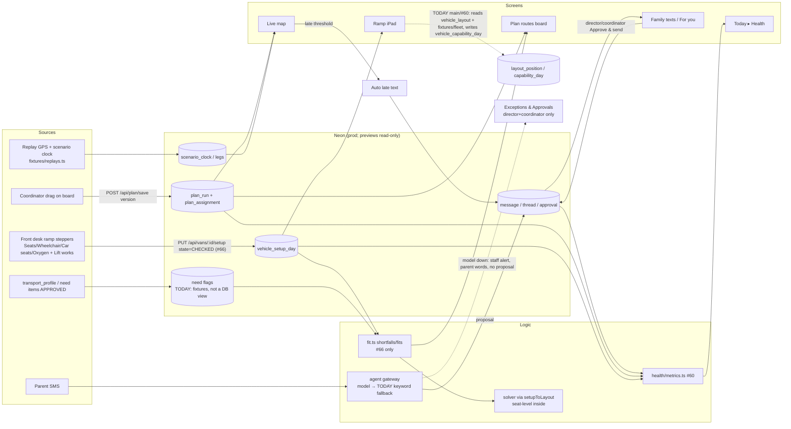

> Mirror of the Notion page "PPEC Data Model (PROPOSED, pending founder sign-off)" — https://app.notion.com/p/3fcac450cdc1813db394ddc7902e63f3 — fetched 2026-10-17 6:05 PM ET (22:05:57 UTC). Converted to Markdown without content edits; Notion tables rendered as Markdown tables. The Notion page is the source of truth. Post-#69 ACCEPTED rules and M10–M14 mirrored; Veri #69 S3 notes and Athena's page sync applied.

# PPEC Data Model (PROPOSED, pending founder sign-off)

> Once the founder signs off, this page supersedes the older "Data model" page (a mirror of `docs/DATA-MODEL.md`). Until then, everything here is PROPOSED.

## Section 1 — Core types (van, day counts, child needs, plan): SIGNED OFF for build 2026-10-17 by Firia (founder final sign-off pending)

| Type | PROPOSED fields | Code today | Mismatch |
|---|---|---|---|
| Van | id uuid, siteId, slot 1..4 (name "Van {slot}", route colour), defaultCounts: VanDayCounts | `ops.vehicle {id, siteId, providerId, label, liftEquipped}` src/db/schema.ts:262-265; #66 `VanConfig` src/config/vans.ts:27-57; `vanNameOf` #66 src/domain/plan/board.ts:116 | Yes: `label` holds an internal code ("V1 convertible van"); defaults live in config, not the DB |
| VanDayCounts | vehicleId, serviceDate (NY date), seats, wheelchair, carSeats, oxygen (smallint ≥0), liftWorks bool, state DEFAULT/PLANNED/CHECKED, confirmedBy, confirmedAt. A van not confirmed today uses the DEFAULT counts from shared config, with no carry-over from yesterday. | `ops.vehicle_setup_day` drizzle/0009_plan_board.sql; schema.ts:301-315 (`wheelchair_spots`, `oxygen_mounts`, `has_lift`, `set_by`, `set_at`); #66 `VanSetup` src/domain/plan/fit.ts:35-40 | Naming only (has_lift vs liftWorks, set_by vs confirmedBy). No 0010 needed; map the names in code |
| ChildNeeds | childToken, wheelchair, carSeat, oxygen, nurse (bool; APPROVED items only) | #66 `NeedFlags` src/config/equipment.ts:26-38; `needsOf` src/domain/plan/needs.ts:51 (from fixtures); legacy `transport_profile` schema.ts:208-214 | Yes: comes from fixtures, not a DB view (view needs 0010) |
| Plan | id, siteId, serviceDate, direction AM/PM, version, savedBy, savedAt | `ops.plan_run` 0009; #66 `SavedPlan` src/modules/plan/types.ts:26-34 | No |
| PlanAssignment | planRunId, childToken, vanId or null, bucket VAN/UNASSIGNED/FAMILY_DRIVES/ABSENT, stopSeq, pinned, shortfall {reason LIFT/WHEELCHAIR/OXYGEN/CAR_SEAT/SEAT, short n} when unplaced | `ops.plan_assignment` 0009; #66 `Placement` board.ts:64; `Shortfall` fit.ts:104 | Partial: shortfall is computed, not stored (fine for the demo) |
| ParentMessage | id, threadId, childToken, direction in/out, body, sentAt, kind (AUTO_LATE / REPLY / INBOUND) | main @ 3553ec5: `ops.message` src/db/schema.ts:416-424 (direction text IN/OUT :417, body_tokenized + body_enc :420, resolved_child_tokens uuid[] :422, received_at :423); `ops.conversation_thread` :403-415; outbox `ops.outbound_message` :432-445 (purpose, template_id, vars jsonb :433-435, child_token :437, state :440); `ops.acknowledgment` :446-450. #61 @ bfe70a5: late text via `etaNoticeTemplate()` src/modules/messaging/eta-notice.ts:195-209, rendered by templates.ts; sim sends write `ops.message` direction OUT (src/modules/messaging/sim-provider.ts:100) | Shape only, no 0010 for the demo: no `kind` column (AUTO_LATE/REPLY = outbound_message.template_id/purpose; INBOUND = message.direction 'IN'); `message` has no single child_token (array `resolved_child_tokens`); plaintext body is only stored encrypted (`body_enc`); outbox and message are two tables, not one |
| AgentProposal | id, threadId, childToken, before→after (stop, time, pickup), replyText, state PENDING/APPROVED/REJECTED, decidedBy (role DIRECTOR or COORDINATOR only), decidedAt | #61 src/modules/agent/run/exec/proposals.ts; src/modules/approvals/decide.ts:51-61 (`rolesWhoCanOpen`) | No. VERIFIED: approval decisions check `approvalRoles()`, which reads the /exceptions access row = director + coordinator only (access.ts:44, main :243 / #61 :241; #61 local head 713e95f, per Rudy) |
| StaffAlert | id, kind NEEDS_PERSON, reason MODEL_UNAVAILABLE, threadId, parentText (verbatim), createdAt, resolvedBy; never carries a proposal. Visibility (SIGNED OFF, Firia): only director and coordinator see it and act on it. Front desk keeps Live map and Ramp iPad only and does NOT see it; access.ts is unchanged. It never sends anything to the parent. Lives in Exceptions & Approvals. | None. Today: keyword fallback src/modules/agent/providers/keyword.ts:1-31,195, used by remote.ts:57 | Yes, blocks demo. **No 0010 needed:** `ops.task` (schema.ts:458-466) carries it. `category` is free text (:459), so NEEDS_PERSON needs no enum change; `severity` RED (:459, enum :60) drives the red count; `state` stays OPEN until opened (task_state :49-51, OPEN→IN_PROGRESS edge src/domain/machines.ts:157); `child_token` :460; existing writer `raiseTask()` src/modules/agent/run/exec/effects.ts:223-246. Gaps that don't need a migration: task has no message/thread FK, so the verbatim parent text is read from `ops.message.body_enc` through an id kept in `completion_evidence` jsonb (:464), not copied into `summary`; there are no opened_at/opened_by columns, so use the IN_PROGRESS transition plus updated_by/updated_at (:92-95). #61's Exceptions page only reads `approval_request` rows of kind DROPOFF_CHANGE (src/modules/approvals/decide.ts:130-142), so it needs a second read for these tasks. Previews refuse writes (src/db/read-only.ts:39-40, VERCEL_ENV=preview), so the alert can't be written on a preview. Roles on main: /exceptions row access.ts:239-245 (path :242, roles CONSOLE :243; CONSOLE = DIRECTOR, COORDINATOR :44). On #61 it's :241-242, and decide.ts:62-64 `approvalRoles()` = `rolesWhoCanOpen('/exceptions')`. Note: #61 @ bfe70a5 still has the `requestedTime` regex reader at src/modules/demo/agent-turn.ts:102-113 |
| Metric | key, value, unit (count), measured bool; HOURS_SAVED / MONEY_SAVED shown as — when not measured | #60 src/domain/health/metrics.ts:47-89 | No mismatch in meaning, but the wording differs. #60 @ 6d73258 prints the words "Not measured yet" on each row, not `—` (src/app/(app)/health/HealthScreen.tsx:262-297 `BaselineRows`; copy.ts:591 `noNumber`). `BASELINE_ROWS` has no value field (metrics.ts:62-63), so no number can appear. Spec §5 l.248 asks for `—` plus "Not measured". Counts come from the board (`Board` import, metrics.ts:40), not `ops.roi_event` (schema.ts:542-545), which no code reads or writes except the seed's wipe list (seed.ts:51) |

Equipment types are listed once, in config (#66 `EQUIPMENT_COUNTERS` src/config/equipment.ts:63-74).
**Sign-off edits (Firia, 2026-10-17):**
1. **VanDayCounts state:** code writes only `DEFAULT` and `CHECKED`. `PLANNED` stays in the frozen 0009 check constraint, but nothing writes it, because the board has no planned counts. The header comment in migration 0009 says the board sets PLANNED; that is out of date. Nothing writes PLANNED, and 0009 stays byte-identical.
2. **Placement:** ONE function, built on the counters in `fit.ts`, places every child and computes every shortfall. The seat-level solver must not make a second placement decision. If it's kept, it only orders stops, and no screen imports its types.
3. **StaffAlert:** only director and coordinator see the 'needs a person' alert and act on it. Front desk keeps Live map and Ramp iPad only and does NOT see it; access.ts is unchanged. It never sends anything to the parent. The model-down path goes to Exceptions & Approvals, not Family texts (the diagram is fixed).
4. **Plan store:** `memory.ts` can't be selected when a database URL is set. It fails closed in prod and in previews.
5. **Day data:** rebuilt screens read day data through one domain interface and never import `@/fixtures` directly. Fixtures sit only behind the demo adapter.
**Approver roles:** VERIFIED, director and coordinator only (access.ts:44, main :243 / #61 :241).
**Note:** sections 4 and 8 (the duplicate time-zone and van-name helpers, and the copy.ts merge) are done inside the rebuild, not as separate PRs.
**ACCEPTED by Firia 2026-10-17 6:01 PM ET (post-#69 additions):**
1. **One source for the plan:** Live map, Today and Health read the saved plan from `plan_run`/`plan_assignment`. An approved drop-off change saves a new plan version; it does not write only to `ops.trip_leg` (today `approvals/decide.ts:268` writes trip_leg).
2. **One roster and one van list** behind the domain interface, with one fleet fixture behind the demo adapter. "Van 3" is the same van on every screen (today there are three fleet fixtures/rosters, e.g. #66 `config/vans.ts:41-60` vs the Live map's V3).
3. **"Day started"** comes only from the database clock (#66 `plan/sql.ts:123`); no browser session storage (#65).
4. **Names:** one name helper in shared helpers; providers never show on screen (today there are duplicate `providerDisplayName` helpers in `fixtures/standard.ts:121` and `ui/copy.ts:58`).
5. **Copy gate:** at most one title and one helper line per screen, plus a copy-location check, enforced by Veri.
**Step locks (Today step strip, PROPOSED):** steps read only `VanDayCounts.state = CHECKED` (counts confirmed) and whether a `Plan` row exists for the date and leg. No screen owns its own 'done' state.
**DEFAULT (Firia's call, pending founder sign-off):** the front desk sets and confirms van counts on the arrival screen. The board only reads them, and the board has no planned counts. A nurse takes a regular seat, so there are four counters only.
Written 2026-10-17, 5:55 PM ET, for the 2026-10-18 demo. Read-only: nothing was pushed, commented or changed, and no env values or secrets were read.
Sources: main @ 3553ec5 (includes 0009 @ adbe1cc), PR #66 @ 38ef27f, #60 (local `pr60`), #61 @ bfe70a5, `/workspace/ppec-redesign/REDESIGN-SPEC.md` (SPEC), `mockups/ramp-arrival.html`, and the Notion page "PPEC transportation dashboard / Data model" (a mirror of `docs/DATA-MODEL.md`).
Everything marked **PROPOSED** waits on founder sign-off.

## 0. Headline
- **The schema is right, but the screens don't use it yet.** Main has the counter tables (0009: `vehicle_setup_day`, `plan_run`, `plan_assignment`), but **no main code reads or writes them**. The only reader/writer is unmerged #66. Nuance: `src/modules/demo/seed.ts:43` lists those three tables in `RESET_TABLES`, so a demo reset truncates them; that is wipe-on-reset only, not an app read or write path.
- **Main and #60 still run on the seat-level layout model**: `vehicle_layout`, `layout_position`, securement, cm sizes, tether and per-position Free/Out/Not sure. That is the "walking seat" screen the founder rejected.
- **The Notion Data model page is stale.** It lists `vehicle / vehicle_layout / layout_position` and has no `vehicle_setup_day`, `plan_run` or `plan_assignment`.

## 1. Entities: code vs spec

| Entity | Code today (cite) | Spec / Notion / mockup | Verdict |
|---|---|---|---|
| Vehicle (Van) | `ops.vehicle {id, siteId, providerId, label "V1 convertible van", liftEquipped}` src/db/schema.ts:262-265 | SPEC §1.6 l.167-170 adds name, color_slot and 5 `default_*` columns | 0009 skipped those columns on purpose (0009_plan_board.sql header). The defaults live in `src/config/vans.ts` (#66 :41-57). Display name comes from `vanNameOf(slot)` (#66 src/domain/plan/board.ts:116) |
| VehicleLayout / LayoutPosition (seat-level) | schema.ts:267-276: `code "1WC/3A"`, `kind WC/AMB`, `securement`, `maxLengthCm/WidthCm`, `tetherCapable`. Enum `securement L_TRACK…` :61 | SPEC §6.1 l.252: "no longer read by Plan routes, Ramp iPad, Family texts"; deferred C3 | **CONTRADICTS** while main RampCheck reads it (below) |
| VehicleCapabilityDay | schema.ts:277-282: `liftOk`, `unavailablePositionIds uuid[]` (per position) | SPEC §6.2: replaced by vehicle_setup_day for these screens | Still written by #60 `observedCapability()` arrival.ts:202-209 |
| VehicleSetupDay (VanDayCounts) | 0009 + schema.ts:301-315: `seats, wheelchair_spots, car_seats, oxygen_mounts smallint; has_lift bool; state text CHECK DEFAULT/PLANNED/CHECKED; set_by uuid→app_user; set_at`; unique(vehicle_id, service_date) | SPEC l.173-177; mockup: 4 steppers + Lift works + Confirm | **MATCHES** (exactly four counters and a lift flag). No main reader, only #66 `src/modules/plan/sql.ts` |
| PlanRun | 0009: `id, site_id, service_date, direction leg_direction, saved_by, saved_at, version`; unique(site,date,dir) | SPEC l.179-180 | MATCHES. Read/write only in #66 |
| PlanAssignment | 0009: PK(plan_run_id, child_token), `vehicle_id null`, `bucket CHECK VAN/UNASSIGNED/FAMILY_DRIVES/ABSENT`, `stop_seq`, `pinned`; CHECK bucket=VAN ⇔ vehicle_id | SPEC l.181-183 | MATCHES. **Gap:** no column stores the shortfall reason for an unplaced child (it's computed by `shortfalls()` in #66 fit.ts:104-113) |
| ChildNeeds | `transport_profile {mobility AMB/WC, wcLengthCm, wcWidthCm, securement, tether, escortRequired, maxRideMinutes}` schema.ts:208-214. #66 `NeedFlags {wheelchair, carSeat, oxygen, nurse}` src/config/equipment.ts:26-38; `needsOf()` src/domain/plan/needs.ts:51 counts only APPROVED items | SPEC §6.4: 4 flags from **view** `ops.child_need_flags` over APPROVED `transport_need_item` | Partial. #66 builds the flags from **demo fixtures** (`DemoChild`, needs.ts:51-67), not from the DB view. No view exists (UNVERIFIED that it's needed for demo) |
| Equipment list | #66 `EQUIPMENT_COUNTERS` (4 keys plus column, reject reason and demand) equipment.ts:45-74; `REJECT_REASONS` :41; UI icons in src/ui/equipment.tsx | SPEC §0 l.38-45, l.106-114 | **GOOD, DRY.** Main has nothing comparable |
| Solver types | src/domain/solver/types.ts:14-67: `Securement`, `WcPosition`, `AmbSeat`, `Layout`, `Child` with mobility/size | SPEC l.118: wrap the solver with `setupToLayout()` | Seat-level types survive behind an adapter (see §4) |
| Approval / AgentProposal | #61 src/modules/approvals/decide.ts (roles from `rolesWhoCanOpen`, :51-61); proposals in src/modules/agent/run/exec/proposals.ts | Director/coordinator approve | Roles are read from the access table rather than named in decide.ts. VERIFIED: approval decisions check `approvalRoles()`, which reads the /exceptions access row = director + coordinator only (access.ts:44, main :243 / #61 :241; #61 local head 713e95f, per Rudy) |
| StaffAlert ("needs a person") | Not a distinct type. Keyword fallback provider `src/modules/agent/providers/keyword.ts:1-31,195` on main, called from `remote.ts:57`; #61 config.ts:269,318 "become a keyword fallback" | Founder: **no keyword/text parser fallback**; staff alert with the parent's words, no proposal | **CONTRADICTS** |
| Metric (Health/ROI) | #60 src/domain/health/metrics.ts:47-89 `ROI_METRICS`, `BASELINE_ROWS HOURS_SAVED/MONEY_SAVED`, `DayCounts` | SPEC §5: counts only; money/hours shown as `—` "Not measured" | Aligned in meaning. Health shows "Not measured yet" for hours and money saved (per Rudy) |
| ParentMessage | `message`/thread tables in schema.ts (see the ParentMessage row in Section 1); late template in #61 src/modules/messaging/templates.ts, eta-notice.ts | SPEC §4 l.237 fixed late template, 12-hour time, stop display name | Resolved (per Rudy): see the ParentMessage row in Section 1 |

## 2. Dataflow

## 3. Mismatches

| # | Item | Spec says | Code does | Severity | PROPOSED fix | 0010? |
|---|---|---|---|---|---|---|
| M1 | Ramp iPad model | 4 steppers + Lift works + Confirm writing `vehicle_setup_day` CHECKED (SPEC §2 l.210-214) | Main `RampCheck.tsx` imports `ARRIVING_VEHICLES` from `@/fixtures/fleet` (:19), renders per-position FREE/OUT/UNSURE (:398), Free/Assign (:466-470), tether row (:420), `chairFitsPosition` cm fit (:681). #60 arrival.ts keeps "walking seat" positions (:145-209, 280-286) and writes `vehicle_capability_day` | **Blocks demo** | Rebuild the Ramp screen on #66's `VanSetup`/`EQUIPMENT_COUNTERS`  • `putSetup(state:'CHECKED')`. Drop #60's arrival.ts layout path, or rebase it onto fit.ts | No |
| M2 | Board persistence | plan in plan_run/plan_assignment | Main has no reader/writer. `src/modules/demo/plan-store.ts` (in-memory Map) is still on main; #66 deletes it and adds `modules/plan/sql.ts`. #66 also keeps `modules/plan/memory.ts` for e2e with no DATABASE_URL | **Blocks demo** until #66 merges | Merge #66. memory.ts cannot be selected when a database URL is set; fails closed in prod and previews. | No |
| M3 | Agent degraded mode | No keyword/text parser. Staff "needs a person" alert with the parent's words, no proposal | `providers/keyword.ts` (main) = PRD "LLM down → keyword parser", wired from `remote.ts:57`; #61 config.ts:269,318 | **Blocks demo** (founder rule). **IN PROGRESS:** removal ships first as a small PR | Replace the keyword provider path with `StaffAlert{kind:'NEEDS_PERSON', parentText, threadId}` in Exceptions & Approvals, with no proposal. Delete keyword.ts | No. `ops.task` carries it: category text, severity RED, state OPEN (see the StaffAlert row) |
| M4 | Child needs source | View `child_need_flags` over APPROVED need items | #66 needs.ts:51-67 reads `DemoChild` fixtures | After demo (demo data is the fixture) | Add the view in 0010. `needsOf` reads the DB | **Yes** |
| M5 | Vehicle defaults/name/colour | `vehicle.name, color_slot, default_*` | config/vans.ts (#66), name `vanNameOf(slot)`; DB `vehicle.label` = "V1 convertible van" (schema.ts:263) still carries the internal code | After demo (if no screen reads label) | 0010: add the columns, or ratify config as the source of truth. Lint that `label` never renders | Yes (if columns) |
| M6 | Shortfall reason | "Mia R. won't fit · 1 car seat short" | Computed live (`shortfalls()`), not stored with UNASSIGNED rows | After demo | Fine computed. Store it only if Health/history needs it | Optional |
| M7 | Seat-level enums/tables | Deferred (C3/C7) | `securement` enum, layout tables, `transport_profile.wc*Cm/tether/maxRideMinutes` live | After demo | Keep the tables (SPEC l.252). Fence them: no screen import of `domain/solver` types | No |
| M8 | Notion Data model page | should mirror code | Lists vehicle_layout/layout_position, none of the 0009 tables | After demo | Regenerate the mirror from `docs/DATA-MODEL.md` after updating that file | No |
| M9 | Approval roles | Director/coordinator | decide.ts reads `rolesWhoCanOpen` (#61 :51-61). VERIFIED: approval decisions check `approvalRoles()`, which reads the /exceptions access row = director + coordinator only (access.ts:44, main :243 / #61 :241; #61 local head 713e95f, per Rudy) | Resolved | Assert the role set in a test | No |
| M10 | Plan source | Live map, Today and Health read plan_run/plan_assignment; an approved change saves a new plan version | approvals/decide.ts:268 writes ops.trip_leg only. Source: Vera's diff list (per Firia; I haven't read the list myself) | Blocks demo | Approval writes a new plan_run version; screens read only the saved plan | No |
| M11 | Roster / van identity | One roster + one van list behind the domain interface; one fleet fixture behind the demo adapter | Three fleet fixtures/rosters (#66 config/vans.ts:41-60 vs Live map V3). Source: Vera's diff list (per Firia; I haven't read the list myself) | Blocks demo | Collapse to one fleet source; Van N is the same van everywhere | No |
| M12 | Day started | Database clock only (#66 plan/sql.ts:123) | #65 uses browser session storage. Source: Vera's diff list (per Firia; I haven't read the list myself) | Blocks demo | Read the started state from the DB; drop sessionStorage | No |
| M13 | Names / providers | One name helper; providers never on screen | Duplicate providerDisplayName: fixtures/standard.ts:121 and ui/copy.ts:58. Source: Vera's diff list (per Firia; I haven't read the list myself) | Blocks demo | One helper in shared helpers; remove provider names from the UI | No |
| M14 | Copy gate | At most one title + one helper line per screen; copy lives in copy.ts | Not enforced. Source: Vera's diff list (per Firia; I haven't read the list myself) | Gate (Veri) | Veri enforces it with a copy-location check | No |

## 4. Abstraction issues
- **Two time-zone constants:** `PROJECT_TIME_ZONE` src/domain/eta/traffic.ts:15 and `SITE_TIME_ZONE` src/ui/service-date.ts:5, plus `site.timezone` column schema.ts:161. PROPOSED: one exported constant (or read the site row).
- **Two van-name helpers:** `vanName(description)` → "the {description}" copy.ts:1169,1506 (main, built on layout descriptions) vs `vanNameOf(slot)` #66 board.ts:116. PROPOSED: one helper in copy.ts that takes slot.
- **Names:** #61 adds src/modules/identity/names.ts (tokenizing, `rosterFromDisplayName`). No single `personDisplayName`/`providerDisplayName` helper was found on main (UNVERIFIED for other PRs).
- **Seat-level types still core:** solver types.ts:14-67 (`WcPosition`, `AmbSeat`, `Securement`), and SPEC l.118 keeps them behind `setupToLayout()`. That's acceptable only if nothing outside `domain/solver` imports them. Main `RampCheck.tsx:18` and `plan-routes/lanes.ts` do.
- **Fixtures coupled to prod code:** `@/fixtures/fleet` in RampCheck.tsx:19 and domain/plan/day.ts:18 (`SERVICE_DATE`); `@/fixtures/replays` in domain/board/day.ts:42, domain/eta/scenario-clock.ts:25, components/map/LiveFleetMap.tsx:38; `modules/demo/fixtures/standard` in domain/plan/map.ts:26. #66 needs.ts derives needs from demo children. PROPOSED: a domain port (`DayDataSource`), with fixtures only behind the demo adapter.
- **Hardcoded:** `COUNTER_MAX = 12` config/vans.ts:62 (#66, in config: OK); #60 `RAMP_DIRECTION = "PM"` arrival.ts:76; #60 occupancy weights `WC ? 3 : tether ? 2 : 1` arrival.ts:286, which contradicts counters.
- **Good:** #66 `EQUIPMENT_COUNTERS` is one config array that drives the fit, the copy keys and the icons.
- **copy.ts growth:** #60 +460, #61 +303, #66 +259 lines on one file, so a three-way merge conflict is certain. Expect it.

## 5. Planner invariants (PROPOSED, for tests)
1. Used never exceeds the confirmed count for any counter (fit.ts `shortfalls` is empty for every van).
2. Every child is in exactly one bucket. An UNASSIGNED child has an exact shortfall (`{reason, short}`).
3. `hasLift=false` ⇒ zero wheelchair riders on that van (fit.ts:113).
4. Deterministic: same inputs give the same plan (stable sort by token).
5. Re-plan after a count change equals a fresh run with the same pins.

## 6. Calls made (DEFAULT: Firia's calls, pending founder sign-off; these replace the earlier founder questions)
1. The front desk sets and confirms van counts on the arrival screen. The board only reads them; there are no planned counts on the board.
2. A nurse takes a regular seat. Four counters only.
3. Van name, colour and defaults stay in shared config for the demo, with no screen hardcoding. Whether to move them to the DB is decided after the demo.
4. Removing the keyword reader ships first, as a small PR (M3, IN PROGRESS).

## 7. Code today (answered by Rudy, main @ 3553ec5)
- NEEDS_PERSON alert: no 0010. `ops.task` (schema.ts:458-466) has free-text `category`, `severity` RED and `state` OPEN, written by `raiseTask()` effects.ts:223-246. The parent's words stay in `ops.message.body_enc`, referenced from `completion_evidence`.
- Message tables: `conversation_thread` schema.ts:403-415, `message` :416-424, `change_request` :425-430, `outbound_message` :432-445, `acknowledgment` :446-450, `suppression` :451-455, `consent_event` :138-146.
- Health: #60 prints "Not measured yet" on the hours and money rows, not `—` (HealthScreen.tsx:262-297, copy.ts:591). There's no value field, so no number can show.

## 8. Shared helpers rule (PROPOSED)
**Rule:** screens use only the shared helpers. That means one person-name, one provider-name and one van-name helper; one New York date/time helper; and copy.ts for every visible word. A screen never formats its own names, dates or labels.
Current duplicates to collapse:
- Time zone: `PROJECT_TIME_ZONE` src/domain/eta/traffic.ts:15, `SITE_TIME_ZONE` src/ui/service-date.ts:5 and `site.timezone` schema.ts:161. Keep one.
- Van name: `vanName(description)` src/ui/copy.ts:1169,1506 vs #66 `vanNameOf(slot)` board.ts:116. Keep the slot-based one, in copy.ts.
- Person/provider name: there's no shared `personDisplayName` / `providerDisplayName` on main. #61 adds src/modules/identity/names.ts (token roster, not display). Found per branch: #60/#63 `providerDisplayName` in src/modules/demo/fixtures/standard.ts:121 (strips the SYN marker; used by src/auth/demo-accounts.ts:76); #61 a second `providerDisplayName` in src/ui/copy.ts:58 (duplicate); #64 `personName` in src/ui/display-name.ts:36; #66 `staffLabel` in src/auth/demo-accounts.ts:77.
- copy.ts: #60, #61 and #66 each add 260–460 lines. Merge them into one file without creating per-screen copy files.
